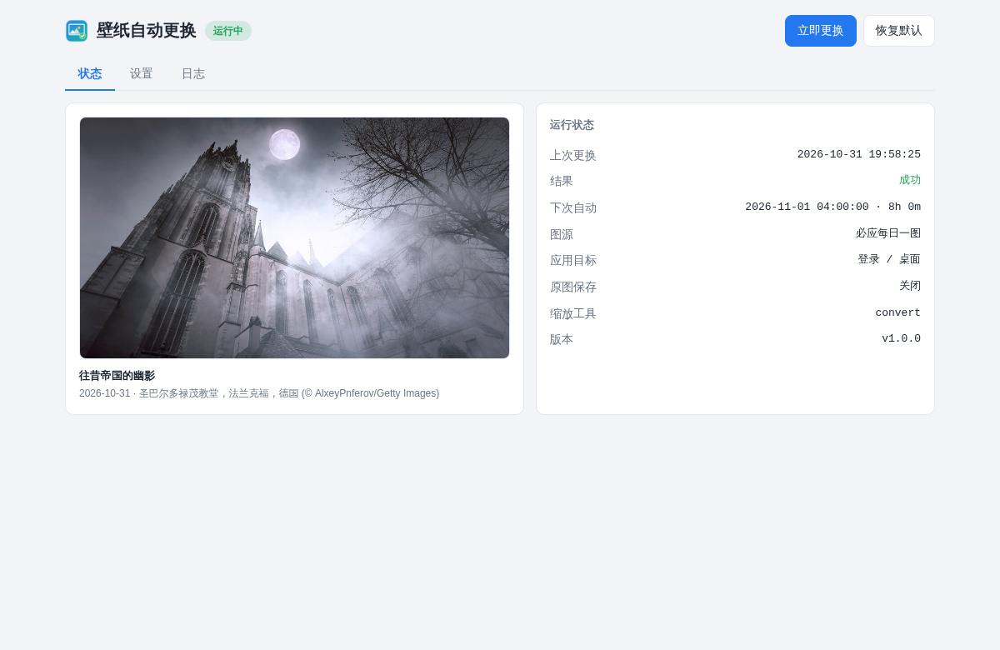
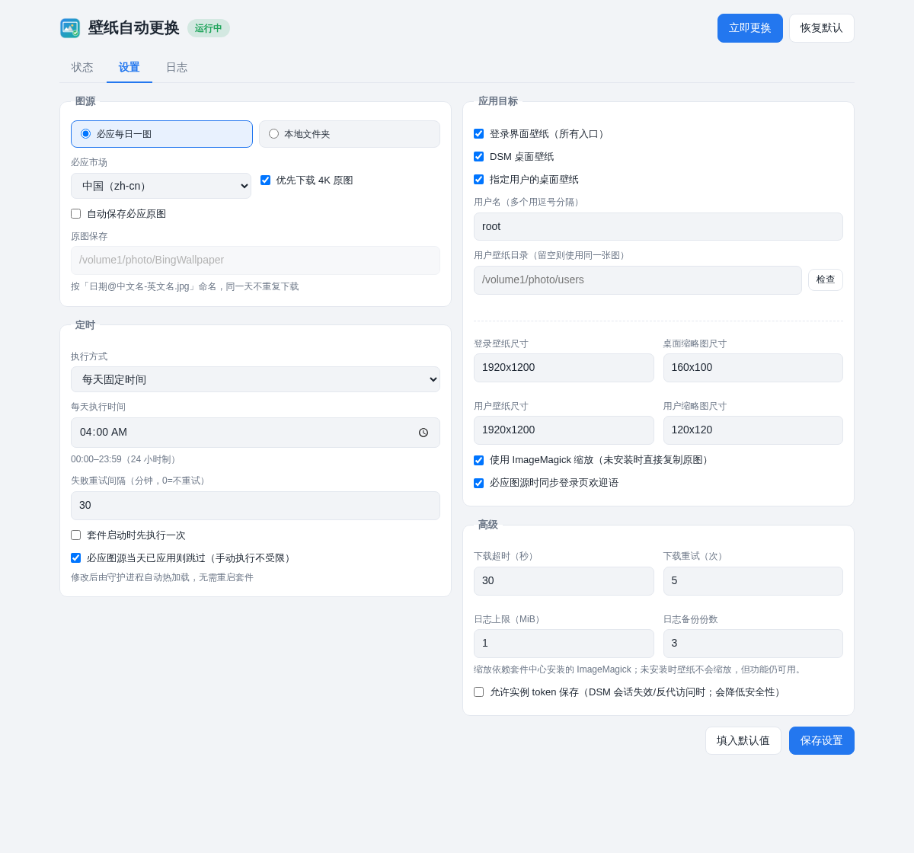

<p align="center">
  
</p>

<h1 align="center">WallpaperChange-DSM</h1>

<p align="center">
  <strong>群晖 DSM 原生壁纸自动更换套件</strong><br>
  必应每日一图 / 本地图片 · 登录壁纸 / DSM 桌面壁纸 / 用户壁纸 · 原生应用窗口
</p>

<p align="center">
  <a href="https://github.com/MeowPerth/WallpaperChange-DSM/releases"></a>
  
  
  
</p>

**WallpaperChange-DSM** 把 [MeowPerth/DSM_AutoChangeWallpaper](https://github.com/MeowPerth/DSM_AutoChangeWallpaper)
从「SSH 脚本 + 任务计划程序」重构为 **Synology DSM 原生套件**。安装后无需 SSH、Docker 或任务计划，
在 DSM 桌面的应用窗口中即可完成图源、目标、尺寸、定时、日志与备份恢复。

- 套件中心手动安装后，DSM 主菜单出现 **壁纸自动更换** 磁贴（英文显示 **WallpaperChange**）；
- 点击以 **DSM 原生应用窗口**打开（可拖动 / 可缩放 / 可最大化）；
- 图源、目标、尺寸、定时、日志全部在窗口内完成，**不需要 SSH、不需要任务计划、不需要 Docker**；
- 保留上游全部能力：必应每日一图、本地图片、登录壁纸、桌面壁纸、用户壁纸、自动保存必应原图。

已在 **SA6400 / DSM 7.4-90075（epyc7002, x86_64）** 实机完成安装、启动、CGI 调用、
必应下载、ImageMagick 缩放、备份与 API 权限验证。

## 界面预览

| 状态页 | 设置页 |
|---|---|
|  |  |

> 状态页为 **SA6400 / DSM 7.4 实机运行截图**；设置页为示例数据（已隐去个人信息）。

## 功能

| 功能 | 说明 |
|:--|:--|
| 双图源 | **必应每日一图**（可选市场 / 4K）或 **本地文件夹**（递归、随机） |
| 三类目标 | **登录壁纸**（含各套件登录页）、**DSM 桌面壁纸**（1x/2x）、**指定用户桌面壁纸** |
| 定时执行 | 每天固定时刻 / 固定间隔 / 仅手动；失败自动重试 |
| 必应原图库 | 自动保存为 `日期@中文名-英文名.jpg`，同一天不重复下载 |
| 备份恢复 | 首次修改前备份系统原图，一键恢复；卸载时自动恢复首次备份 |
| 可见即可得 | 状态页显示当前壁纸预览、上次结果、下次执行与警告；日志页查看运行日志 |
| 原生窗口 | DSM 桌面磁贴 + 内嵌应用窗口，不新开浏览器页签 |
| 零监听端口 | UI → `api.cgi`（DSM nginx 执行）→ unix socket → root 守护进程 |
| 权限隔离 | 套件以 `sc-autowallpaper` 运行；仅一个固定功能的 setuid helper 可执行 root 操作 |

## 系统要求

| 项目 | 要求 |
|:--|:--|
| DSM | **7.2-64570 及以上**；已在 DSM 7.4-90075 实机验证 |
| 架构 | **x86_64 / epyc7002**（当前构建面向 SA6400；其他 x86_64 机型可自行重新编译 helper） |
| 权限 | 安装/修改需要 DSM 管理员；套件用户 `sc-autowallpaper`，root 由 setuid helper 授权 |
| Python | 3.7+；DSM 7.2+ 通常自带 `python3`，若没有请先在套件中心安装 **Python 3.9** |
| 图像缩放 | 可选；DSM 自带 ImageMagick 6（`/usr/bin/convert`），SynoCommunity ImageMagick 7 也兼容 |
| 网络 | 必应图源需要 NAS 能出站访问 `www.bing.com`（443） |

## 安装

1. 从 [Releases](https://github.com/MeowPerth/WallpaperChange-DSM/releases) 下载最新 `.spk`，
   或使用仓库内 `dist/autowallpaper_x86_64-dsm7_1.0.0-0011.spk`；
2. 套件中心 → 右上角「手动安装」→ 选择该 `.spk`；
3. 提示「发布者未经 Synology 验证」属正常（未申请官方签名），继续；
4. 安装完成后，DSM 主菜单出现 **壁纸自动更换**（英文显示 **WallpaperChange**，仅管理员可见），点击打开；
5. 若套件状态为「已停止」，在套件中心点「启动」。

> 若磁贴未出现，注销并重新登录 DSM 刷新主菜单缓存。
>
> 若未安装 ImageMagick，功能不受影响：壁纸会按原图直接复制，由 DSM 自适应显示。

### 为什么安装时不需要手动给 root

DSM 7.4 会拒绝未签名第三方套件直接声明 `run-as: root`（`invalid package privilege content`
或 `failed to revise file attributes`）。本套件采用 Synology 允许的默认权限安装：

```
conf/privilege:
  defaults.run-as = package          → 套件脚本以 sc-autowallpaper 运行
  tool:
    bin/wallpaper-helper             → root:package 6550（setuid）
    bin/wallpaper-daemon.py          → root:package 0700（仅 root 可读/执行）
```

`wallpaper-helper` 是一个 **只支持 start / stop / status / restore / cleanup 五个固定模式**
的小型静态 C 程序，不接受任意命令或参数；DSM 在安装时自动完成 setuid 授权。
守护进程由 helper 以 root 启动，因此写入系统壁纸不需要用户手动配置 sudo。

## 首次使用

打开应用窗口 → 「设置」：

1. **图源**：选「必应每日一图」并选市场；或选「本地文件夹」并填入真实路径
   （例如 `/volume1/photo`，不是 File Station 里显示的 `/photo`）。
2. **应用目标**：勾选登录壁纸 / 桌面壁纸；需要给指定用户换壁纸时勾选用户并填用户名。
3. **定时**：默认每天 `04:00`；也可以改成固定间隔或仅手动。
4. 点「保存设置」→ 回到「状态」→「立即更换」。

生效方式：

- **登录壁纸**：退出 DSM 后重新打开登录页（浏览器可能缓存，Ctrl+F5 强制刷新）；
- **桌面壁纸**：重新登录或刷新 DSM；
- **登录页欢迎语**：必应图源下会自动写入标题与图片说明，重新打开登录页可见；
- **用户壁纸**：建议该用户至少登录过一次 DSM；若用户在「个性化」里重新选过壁纸，DSM 可能覆盖套件设置。

## 与上游脚本的对应关系

| 上游 `AutoChangeWallpaper.sh` | 本套件 |
|:--|:--|
| `localWallpaperPath` | 图源 = 本地文件夹，`local_dir` |
| 必应 `mkt=zh-cn` | `bing_market`，可选中国/美国/日本/德国/法国/英国/自动 |
| `wallpaperSavePath` | 「自动保存必应原图」+ 保存目录 |
| `userLocalWallpaperPath` + `userName` | 「用户壁纸目录」+ 用户名列表 |
| `LOGIN_WALLPAPER_SIZE` | 登录壁纸尺寸 |
| `THUMBNAIL_SIZE` | 桌面缩略图尺寸 |
| `USER_WALLPAPER_SIZE` / `USER_THUMB_SIZE` | 用户壁纸 / 用户缩略图尺寸 |
| 手动运行脚本 | 状态页「立即更换」 |
| DSM 任务计划 | 内置调度器（热加载，改完即生效） |
| 注释/取消注释配置 | 应用窗口表单 |

上游脚本每次运行都会重新下载并覆盖系统文件；本套件增加了**状态持久化、失败重试、备份恢复、日志滚动**。

> 必应图片版权归 Microsoft / 原作者所有；「自动保存必应原图」仅用于个人壁纸库，请勿用于商业分发。

## 工作原理

```
DSM 桌面磁贴（ui/config + dsm-wrapper.js）
  └─ 应用窗口 → iframe → /webman/3rdparty/autowallpaper/index.html
        └─ fetch api.cgi?action=...
              └─ CGI（nginx/http 执行）
                    ├─ 官方 authenticate.cgi 校验 DSM 会话 → 用户名头
                    └─ unix socket（/var/run/autowallpaper.sock，0660 root:http）
                          └─ wallpaper-daemon.py（root，由 setuid helper 启动）
                                ├─ 调度器（每天/间隔/重试）
                                ├─ 必应下载 / 本地选图
                                ├─ ImageMagick 缩放（可选）
                                ├─ 写系统壁纸 + /etc/synoinfo.conf
                                ├─ 备份 / 恢复
                                └─ var/config.json、state.json、wallpaper.log*
```

- **权限**：登录壁纸、桌面壁纸、用户偏好目录、`/etc/synoinfo.conf` 都是 root 文件；
  守护进程以 root 运行，但**套件本身**以 `sc-autowallpaper` 运行，root 入口只有
  setuid helper 的五个固定模式。
- **认证**：`api.cgi` 在 CGI 环境执行官方 `authenticate.cgi`；daemon 对写操作额外校验
  `administrators` 组。安装时生成的实例 token 只作为**只读兜底**（反代/自定义域名场景），
  不能用于修改配置。
- **零端口**：daemon 只监听 unix socket，socket 属主 `root:http`、权限 `0660`；
  `sc-autowallpaper` 通过 `join-groupname: http` 加入 http 组，CGI 可连接，其他本地用户不可。

## 系统文件与备份

| 位置 | 作用 |
|:--|:--|
| `/usr/syno/etc/login_background.jpg` 等 8 个文件 | 登录页 / 各套件登录背景 |
| `/usr/syno/synoman/webman/resources/images/{1x,2x}/{default_login_background,default_wallpaper}/dsm7_01.jpg` | DSM 桌面壁纸 |
| 同上目录的 `thumbnail_01.jpg` | 壁纸选择器缩略图 |
| `/usr/syno/etc/preference/<用户名>/wallpaper`、`1.jpg`、`1thumb.jpg` | 指定用户桌面壁纸 |
| `/etc/synoinfo.conf` | `login_background_customize`、`login_welcome_title`、`login_welcome_msg` |

**备份机制**：第一次改动任一文件前，原文件复制到
`/var/packages/autowallpaper/var/backup/`，并在 `manifest.json` 中记录原路径、权限、
属主，以及 `synoinfo.conf` 中相关键的原始值。之后每天的更换不会重复备份。

**恢复默认**：

- 应用窗口「恢复默认」：把备份复制回去，删除本套件新建的文件，恢复/删除 `synoinfo.conf`
  的键，并删除预览图；
- 卸载套件：`preuninst` 通过 setuid helper 自动执行同样的恢复，然后保留数据目录。

> 若你此前用上游脚本换过壁纸，首次应用时备份到的就是「当时的壁纸」，恢复会回到那个状态。

备份安全：`restore` 只接受登录壁纸、桌面壁纸、用户壁纸和 `synoinfo.conf` 的白名单路径；
`manifest` 中的 synoinfo 原值会重新转义后再写入，不会直接执行原始行。

## 图像处理

- 优先使用 ImageMagick：DSM 自带 ImageMagick 6（`/usr/bin/convert`）；
  也兼容 SynoCommunity 的 ImageMagick 7（`magick`）与常见安装路径。
- 缩放命令等价于 `convert <src> -auto-orient -resize "1920x1200>" -strip -quality 90 ...`，
  `>` 表示**只缩小、不放大**，不会拉伸变形。
- 未安装 ImageMagick 或缩放失败时，自动退化为**直接复制原图**，并在运行结果的「提示」中标注；
  功能仍然可用，只是文件更大、缩略图不是小图。
- 必应 4K：勾选「优先下载 4K 原图」时先尝试 `_UHD.jpg`，失败自动回退到普通 1920×1080。

## 定时与重试

| 配置 | 说明 |
|:--|:--|
| 每天固定时间 | 本地时区 24 小时制 `HH:MM`（`00:00–23:59`），跨天自动计算；默认 `04:00` |
| 固定间隔 | 距上次执行 N 分钟（5–10080） |
| 仅手动 | 不自动执行，只响应「立即更换」 |
| 失败重试 | 上次失败后 `retry_minutes` 分钟内重试（默认 30 分钟，0=关闭） |
| 当天跳过 | 必应图 `enddate` 与上次相同则跳过（手动执行不受限） |
| 启动时执行 | 套件启动/DSM 重启后先执行一次，适合修复 DSM 升级重置壁纸 |

调度器每 30 秒读取一次配置文件的 mtime，修改设置后无需重启套件。

## 日志与数据

```
/var/packages/autowallpaper/var/   →   /volumeX/@appdata/autowallpaper/
├── config.json          配置（升级/卸载保留）
├── state.json           上次执行、必应日期、预览版本等
├── token                实例 token（0640，只读兜底）
├── wallpaper.log        守护进程日志（按大小轮转，默认 1 MiB × 3）
├── wallpaper.log.1..3
├── service.log          启停脚本日志（sc-autowallpaper 可写，256 KiB 上限）
├── api-auth.log         会话校验未命中的脱敏诊断
└── backup/              系统壁纸备份与 manifest.json（root 所有）
```

`target/ui/preview.jpg` 是状态页预览图，随每次更换覆盖。

**卸载不会删除配置/备份**；彻底清除请手动删除 `@appdata/autowallpaper` 目录。
注意：删除后再次卸载将无法恢复首次备份（备份已不存在）。

## 从源码构建

```bash
./build.sh
# → dist/autowallpaper_x86_64-dsm7_1.0.0-0011.spk
```

构建机需要：**x86_64 Linux**、bash、tar、gzip、md5sum、python3、**gcc（静态编译）**。
不需要 Synology SDK / Toolkit。

`build.sh` 会：

1. 用 Python `compile()`、`sh -n` 做语法自检；
2. 用 `gcc -static` 编译 `src/bin/wallpaper-helper.c`；
3. 组装 `package.tgz`（`bin/`、`ui/`、`var/`）；
4. 计算 `package.tgz` 的 md5 写入 `INFO` 的 `checksum`；
5. 生成未压缩 tar 的 `.spk`（`INFO + package.tgz + scripts + conf + 图标 + LICENSE`）。

> 如需 ARM 机型，请用对应架构重新编译 `wallpaper-helper`，并把 `INFO` 的
> `arch` 改为目标平台（如 `armv8`）后重新打包。

## 本地调试（无需 NAS）

```bash
python3 tests/test_local.py      # 核心逻辑 + fake root 写入/恢复测试
```

手工启动 daemon（TCP 调试模式，任意目录）：

```bash
mkdir -p var
cp spk/var-default-config.json var/config.json
python3 src/bin/wallpaper-daemon.py \
  --listen tcp:127.0.0.1:8686 --auth none \
  --root /tmp/fakeroot --ui-dir /tmp/ui
```

- `--root`：把所有 DSM 系统路径映射到 `/tmp/fakeroot`，不会改本机真实文件；
- `--auth none`：仅本地调试使用，生产环境默认 `unix` 认证；
- 浏览器直接打开 `src/ui/index.html` 时没有 CGI，需要自行把 `/api/*` 请求指向 TCP 端口。

## 命令行（可选）

套件功能都可在窗口内完成；需要脚本化时，可以 root 调用 daemon：

```bash
# 立即执行一次（使用 var/config.json 的配置）
sudo /usr/bin/python3 /var/packages/autowallpaper/target/bin/wallpaper-daemon.py --once

# 恢复首次备份的默认壁纸（先停止套件）
sudo /var/packages/autowallpaper/target/bin/wallpaper-helper restore
```

`--once` 输出 JSON 结果；`--restore` 与窗口里的「恢复默认」等价。

## 目录结构

```
├── build.sh                       # 一键打包 → dist/*.spk
├── src/
│   ├── bin/
│   │   ├── wallpaper-daemon.py    # 守护进程：图源/缩放/备份/调度/HTTP API
│   │   └── wallpaper-helper.c     # setuid helper（start/stop/status/restore）
│   └── ui/
│       ├── index.html             # 应用窗口单页（内联 CSS/JS）
│       ├── api.cgi                # CGI → daemon unix socket
│       ├── config                 # DSM 桌面磁贴注册
│       ├── dsm-wrapper.js         # 原生应用窗口（Ext JS 类）
│       └── images/                # 16~256px 图标
├── spk/
│   ├── scripts/
│   │   ├── installer              # 安装/卸载/升级逻辑 + var 同步 + token 注入
│   │   ├── service-setup          # 服务变量 + python3 探测
│   │   ├── start-stop-status      # start|stop|status|log（经 setuid helper）
│   │   └── preinst ... postupgrade# 薄壳
│   ├── conf/privilege             # package user + tool(setuid) 授权
│   └── var-default-config.json    # 默认配置
├── tests/test_local.py            # 无 NAS 单元/集成测试
├── tools/make_icons.py            # 纯标准库图标生成
├── docs/screenshots/              # 界面预览图
└── dist/                          # 构建产物
```

## 已知限制

- 本 SPK 为 **x86_64** 构建；其他架构需要重新编译 helper 并修改 `INFO.arch`。
- 图片格式支持 `jpg/jpeg/png/webp/bmp`；HEIC、RAW 等需要 ImageMagick 对应 delegate，默认不支持。
- 用户壁纸写入 DSM 的用户偏好目录；若该用户在「个性化」中重新选择壁纸，DSM 可能覆盖套件设置。
- DSM 大版本升级可能重置系统壁纸；建议勾选「套件启动时先执行一次」。
- 登录壁纸/欢迎语的显示受浏览器缓存影响，需要退出登录或强制刷新。
- 套件依赖 DSM 的 webman CGI 与 `/var/run` unix socket；极少数深度定制的 DSM 环境如无法连接，可查看 `var/wallpaper.log` 与套件日志。

## 常见问题

**Q：套件中心提示「不支持此套件」/ 安装失败？**
确认 DSM **7.2+**、架构 **x86_64 / epyc7002**（当前构建面向 SA6400），并核对 `INFO` 中的 `os_min_ver` 与 `arch`。
若之前装过同名测试版并出现 `error 313`，先卸载，并用管理员 SSH 清理遗留账户：

```bash
sudo /usr/syno/sbin/synouser --del sc-autowallpaper
sudo /usr/syno/sbin/synogroup --del autowallpaper
```

然后再安装。正常升级不需要这一步。

**Q：主菜单里没有「壁纸自动更换 / WallpaperChange」？**
只有 `administrators` 组成员可见；注销并重新登录 DSM 刷新菜单缓存。

**Q：点击磁贴打开空白/提示 daemon unreachable？**
套件中心确认套件为「运行中」；查看 `var/wallpaper.log`、`var/service.log` 与套件日志
`/var/log/packages/autowallpaper.log`。常见原因是 Python 3 不可用或 CGI 无法连接 socket。

**Q：登录壁纸换了但登录页没变？**
退出登录后重新打开登录页，并强制刷新（Ctrl+F5）。File Station、Video Station 等套件
登录页也使用独立背景文件，本套件会一并更新。

**Q：桌面壁纸没变？**
重新登录 DSM 或 Ctrl+F5；DSM 桌面壁纸有浏览器缓存。

**Q：用户壁纸没生效？**
该用户至少登录过一次，且没有在「个性化」中重新选择壁纸；套件写入的是
`/usr/syno/etc/preference/<user>/wallpaper`、`1.jpg`、`1thumb.jpg`。

**Q：保存时提示「当前为只读 token 认证」？**
说明 `authenticate.cgi` 无法识别当前 DSM 会话（常见于会话过期、IP/域名变化、反代访问）。
可在「高级」勾选「允许实例 token 保存」后重试；本机已启用。若仍失败，退出 DSM 并在
同一地址重新登录后再保存。

**Q：提示「未安装 ImageMagick」？**
DSM 通常自带 `/usr/bin/convert`；若你的机型/版本没有，可在套件中心安装
SynoCommunity 的 ImageMagick。不安装也能用，只是不缩放、文件更大。

**Q：必应接口失败 / 证书错误？**
下载失败会保留原壁纸并记录日志；证书链异常时会降级为不校验证书并告警一次。
可检查 NAS 的 DNS、出站 443 与系统时间。

**Q：DSM 升级后壁纸被重置？**
勾选「套件启动时先执行一次」，DSM 重启后会自动重新应用。

**Q：如何彻底删除？**
套件中心卸载（会自动恢复首次备份的壁纸）→ 手动删除
`/volumeX/@appdata/autowallpaper`。

## 安全说明

- 套件以 `sc-autowallpaper` 运行；root 入口只有 `wallpaper-helper`，且其模式被限制为
  start / stop / status / restore / cleanup，不接受任意命令。
- helper 由 DSM 通过 `conf/privilege` 的 `tool` 授权为 `root:autowallpaper 6550`；
  `wallpaper-daemon.py` 为 `root:autowallpaper 0700`，套件用户不可修改。
- UI 仅管理员可见，daemon 对写操作再次校验 `administrators` 组。
- 实例 token 默认只读：可以读取状态/配置以兼容反向代理，但不能修改配置或更换壁纸。
  高级选项「允许实例 token 保存」可放开写权限；开启后任何能读取 `index.html` 的 DSM 用户
  都可能获得该 token，请仅在单管理员/可信环境使用。
- 不监听 TCP 端口，socket 权限 `0660 root:http`；`api-auth.log` 只记录 Cookie 字段名、
  地址形态等脱敏信息，不记录凭据。
- 备份恢复有目标路径白名单，synoinfo 原值重新转义，降低 manifest 被篡改后的风险。

## 更新日志

### 1.0.0-0011

- 套件显示名称调整为：默认 **壁纸自动更换**，英文 **WallpaperChange**。
- 应用窗口/菜单磁贴标题同步为「壁纸自动更换」；英文界面标题为 WallpaperChange。
- 无功能变更。

### 1.0.0-0010

- 项目更名为 **WallpaperChange-DSM**；套件 `INFO` 的开发者/支持链接同步指向新仓库。
- 无功能变更。

### 1.0.0-0009

- 更新套件 `INFO` 中的开发者/支持链接，统一指向本项目
  `https://github.com/MeowPerth/WallpaperChange-DSM`；无功能变更。
- README 增加「开发者」区块。

### 1.0.0-0008

- 「每天执行时间」由自由文本改为浏览器原生 `time` 控件（`min=00:00`、`max=23:59`、`step=60`），
  增加行内「00:00–23:59（24 小时制）」提示与红框校验；`33:00` 之类的值无法保存。
- 后端仍保留 `daily_time` 正则校验作为兜底。

### 1.0.0-0007

- 新增高级选项 **「允许实例 token 保存」**（`token_write`，默认关闭）。
  在自定义域名/反向代理访问、或 DSM 会话失效时，页面会退化为只读 token；
  启用后 token 也可保存配置，避免“只读 token”导致无法保存。
- 注意：静态页面可被任何已登录 DSM 用户读取，token 也会随之暴露；多用户环境请保持关闭。
  本机（单管理员、自定义域名访问）已启用。

### 1.0.0-0006

- 修复「日志上限（MiB）」输入框 `min=0.0625` 与 `step=0.5` 不匹配的问题：
  浏览器会把 `1` 判为无效（合法值变成 0.5625、1.0625…），导致设置无法保存。
  现在 `step=0.0625`，1 MiB、1.5 MiB 等都可正常保存。

### 1.0.0-0005

- **升级时不再恢复壁纸**：DSM 升级也会调用 `preuninst`（`STATUS=UPGRADE`），
  旧版本会在此时误触发恢复；现在仅在真正卸载时恢复首次备份。
- 保留 0004 的设置页两栏布局修复与 `#config` / `#logs` 深链。

### 1.0.0-0004

- 修复设置页左栏「图源」下方因两栏高度不一致产生的大块空白：改为固定两栏，
  左栏「图源 + 定时」、右栏「应用目标 + 高级」；窄屏按 图源 → 应用目标 → 定时 → 高级 排列。
- 应用窗口支持 `#config` / `#logs` 深链，方便直接打开设置页或日志页。

### 1.0.0-0003

- 适配 DSM 7.4：改用 `sc-autowallpaper` + setuid helper 授权 root，解决未签名第三方
  套件无法直接 `run-as: root` 的安装失败。
- 加固备份恢复路径白名单与 synoinfo 值转义。
- 启停日志与 daemon 日志拆分；HTTP 连接断开不再刷 traceback。
- 实机验证：SA6400 / DSM 7.4-90075，登录/桌面壁纸、CGI、API、ImageMagick、备份均正常。

### 1.0.0-0001

- 首个 SPK 版本：必应 / 本地图源，登录 / 桌面 / 用户壁纸，定时与失败重试，
  备份恢复，DSM 原生应用窗口，日志滚动。

## 开发者

- **维护者**：MeowPerth
- **项目主页**：<https://github.com/MeowPerth/WallpaperChange-DSM>
- **问题反馈**：<https://github.com/MeowPerth/WallpaperChange-DSM/issues>
- **上游脚本**：[MeowPerth/DSM_AutoChangeWallpaper](https://github.com/MeowPerth/DSM_AutoChangeWallpaper)（MIT）

## 致谢

- 上游脚本与设计：[MeowPerth/DSM_AutoChangeWallpaper](https://github.com/MeowPerth/DSM_AutoChangeWallpaper)（MIT）
- DSM 应用窗口注册思路参考本工作区的 IP-Monitor SPK 实现
- setuid helper 受 [SynoSmartInfo](https://github.com/PeterSuh-Q3/SynoSmartInfo) 的 privilege `tool` 方案启发
- 图标由 `tools/make_icons.py` 纯标准库生成

## License

MIT，见 [LICENSE](LICENSE)。
